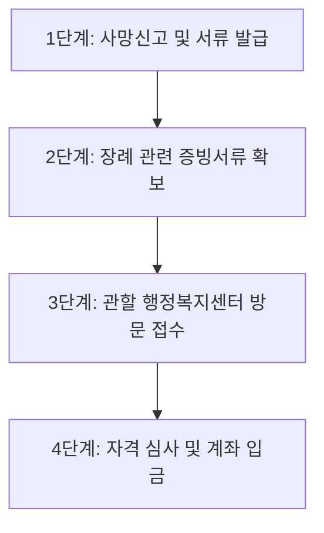

가족이나 가까운 혈육을 떠나보내는 일은 그 어떤 슬픔과도 비교할 수 없을 만큼 가슴 아픈 일입니다. 하지만 황망한 마음을 추스르기도 전에 현실로 닥쳐오는 병원비와 장례비 고지서는 유족들의 어깨를 더욱 무겁게 짓누르곤 합니다. 최근 가파르게 치솟은 물가와 차량 유류비, 인건비 탓에 기본적인 장례를 치르는 데만도 수백만 원에서 천만 원 안팎의 큰 비용이 소요되는 것이 냉혹한 현실입니다. 

특히 수정구나 중원구의 구도심 골목에서 오랫동안 삶의 터전을 일궈오셨거나, 분당구 영구임대단지 등에서 빠듯한 생계비로 하루하루를 버텨오신 취약계층 가정이라면 이러한 장례 비용은 감당하기 버거운 큰 빚으로 남기도 합니다. 

성남시에서는 이처럼 경제적 사정이 어려운 기초생활수급자 가구가 고인의 마지막 가시는 길을 존엄하게 모실 수 있도록, 국가에서 기본적으로 나오는 장제급여와는 별개로 **성남시 자체 예산으로 '영구차 운구비 20만 원'을 추가 지원**하고 있습니다. 10년 넘게 성남의 골목 구석구석을 누비며 복지 현장을 지켜본 에디터가 실제 행정복지센터 창구에서 어떻게 신청해야 반려 없이 한 번에 받을 수 있는지 그 구체적인 방법과 놓치기 쉬운 핵심 포인트를 조목조목 정리해 드립니다.

---

## 1. 핵심 혜택 및 지원 금액 상세 안내

성남시의 '국민기초생활수급자 운구비 지급 사업'은 고인의 마지막 이동 수단인 영구차량(장의차량) 이용 비용의 일부를 지자체 재정으로 보조해 드리는 제도입니다.

> **💡 지원 핵심 요약**
> * **지원 금액:** 고인 1인당 영구차 운구비 **현금 20만 원** 지급 (신청 계좌 입금)
> * **지급 대상자:** 실제로 장례를 치르고 비용을 부담한 유족(배우자, 자녀, 부모, 형제자매 등) 또는 장례를 직접 주관한 연고자
> * **지급 방식:** 신청서 접수 및 자격 심사 후 신청인 명의의 금융계좌로 현금 입금

많은 분이 "기초생활수급자가 사망하면 원래 나라에서 나오는 80만 원짜리 장제급여가 있는데, 이것과 무엇이 다른가요?"라고 질문하십니다. 이 사업은 국민기초생활보장법에 따라 전국 공통으로 지급되는 보건복지부의 **'국가 장제급여(통상 80만 원)'와 중복해서 추가로 받을 수 있는 성남시만의 고유 특화 혜택**입니다. 즉, 성남시민 수급자 유족이라면 국가 장제급여 80만 원에 성남시 운구비 20만 원을 더해 **총 100만 원 상당의 장례비 지원**을 받으실 수 있는 셈입니다.

장례를 치를 때 병원 영안실이나 장례식장에서 화장장(성남시장례문화사업소 등) 및 장지까지 이동하는 운구차량 대여 비용은 필수 지출 항목 중 하나입니다. 비록 전체 장례비에 비하면 20만 원이 큰 액수가 아닐 수 있지만, 막막한 형편의 유족들에게는 조금이나마 숨통을 틔워주는 든든한 디딤돌이 되어줍니다.

---

## 2. 지원 자격 조건 및 대상 급여 기준

운구비 지원을 받기 위해서는 단순히 기초생활수급자였다는 사실만으로는 부족하며, **성남시 거주 기간**과 **급여 유형**이라는 두 가지 필수 요건을 동시에 충족해야 합니다.

### (1) 거주 기간 요건
사망일(사망진단서 상의 사망일자) 기준으로 **성남시 관내(수정구·중원구·분당구)에 주민등록을 두고 계속하여 1년 이상 연속 거주**한 기록이 있어야 합니다. 과거에 성남에 10년을 살았더라도 타 지역으로 전출했다가 성남으로 다시 전입한 지 6개월 만에 사망하셨다면 아쉽게도 대상에서 제외됩니다. 주민등록초본 상의 '최근 전입일'로부터 1년이 경과했는지가 판단 기준이 됩니다.

### (2) 기초생활보장 수급 자격 요건
기초생활수급자라고 해서 모든 유형이 다 해당되는 것은 아닙니다. 정부 기초생활보장제도의 4대 급여(생계·의료·주거·교육) 중 어느 급여에 속해 있었는지가 매우 중요합니다.

| 구분 | 지원 대상 여부 | 비고 및 세부 기준 |
| :--- | :---: | :--- |
| **생계급여 수급자** | **지원 가능 (O)** | 기준 중위소득 32% 이하 가구 (가장 일반적인 지원 대상) |
| **의료급여 수급자** | **지원 가능 (O)** | 기준 중위소득 40% 이하 가구 (1종·2종 수급권자 모두 포함) |
| **주거급여 수급자** | **지원 가능 (O)** | 기준 중위소득 48% 이하 가구 (임차급여·수선유지급여 대상) |
| **교육급여 수급자 (단독)** | **지원 불가 (X)** | 교육급여만 단독으로 받는 가구는 운구비 지원 대상에서 제외 |
| **차상위계층 (단독)** | **지원 불가 (X)** | 차상위 본인부담경감, 차상위계층확인사업 대상자는 제외 |

위 표에서 확인할 수 있듯, **생계·의료·주거급여 수급자 중 하나 이상에 해당하면서 성남시에 1년 이상 계속 거주하셨던 고인**이 대상입니다. 만약 교육급여만 단독으로 지원받던 가구라면 본 사업 지원 대상에서 빠지므로 사전에 고인의 복지 자격 상태를 면밀히 체크해야 합니다.

---

## 3. 단계별 신청 절차 및 필수 지참 서류

장례를 마치고 슬픔이 채 가시지 않은 상태에서 행정기관을 여러 번 오가는 것은 무척 고된 일입니다. 아래 4단계를 차근차근 확인하시고 서류를 완벽히 챙겨 가시면 단 한 번의 방문으로 깔끔하게 접수를 끝낼 수 있습니다.

### 4단계 원스톱 신청 가이드

* **1단계: 장례 종료 및 병원 서류 확보**
  병원에서 발급한 사망진단서(또는 사체검안서) 원본 2~3부를 넉넉히 발급받습니다. 장례식장 이용 내역과 운구차량 이용 명세를 확인합니다.
* **2단계: 관할 동 행정복지센터 방문 (사망신고 병행)**
  고인의 주민등록상 주소지 관할 동 행정복지센터(주민센터) 복지민원 창구를 방문합니다. 이때 사망신고와 운구비 신청, 국가 장제급여 신청을 한 자리에서 동시에 진행하는 것이 가장 현명합니다.
* **3단계: 신청서 작성 및 구비 서류 제출**
  창구에 비치된 '운구비 지급 신청서'를 작성하고, 실제 장례를 치른 유족의 신분증과 통장 사본을 제출합니다.
* **4단계: 구청 복지과 심사 및 운구비 지급**
  동 행정복지센터에서 서류를 접수한 뒤 각 구청(수정구청·중원구청·분당구청) 사회복지과로 이송하여 최종 전산 조회를 거칩니다. 통상 접수일로부터 7일~14일 이내에 신청인 계좌로 20만 원이 입금됩니다.

---

### 반드시 챙겨야 할 필수 구비 서류 체크리스트

방문하시기 전 지갑과 가방 속 서류를 하나씩 체크해 보세요.

* [ ] **사망진단서 또는 시체검안서 1부** (사망 사실 확인용)
* [ ] **영구차(운구차량) 이용 영수증 1부** (장의차량 업체 직인이 날인된 세금계산서, 영수증, 또는 장례비 세부정산내역서)
* [ ] **신청인(유족) 신분증** (주민등록증, 운전면허증, 여권 등)
* [ ] **신청인 명의 통장 사본 1부** (압류방지 전용통장은 입금이 제한될 수 있으므로 일반 입출금 통장 권장)
* [ ] **가족관계증명서(상세) 1부** (고인과 신청인 간의 가족관계를 증명할 수 있는 서류)
* [ ] *(해당 시)* **위임장 및 위임자 인감증명서** (직계 유족이 아닌 대리인이 접수할 경우)

---

## 4. [에디터 실전 꿀팁] 성남 관내 복지센터 이용 노하우

10년 넘게 성남시 행정을 지켜보며 유족분들이 창구에서 겪는 혼선과 반려 사례를 자주 접했습니다. 아래 팁을 미리 알고 가시면 헛걸음을 확실하게 줄일 수 있습니다.

> **💡 에디터의 현장 조언 3가지**
> 
> 1. **사망신고 당일에 무조건 '동시 신청'하세요.**
>    사망 후 1개월 이내에 동 행정복지센터에서 사망신고를 해야 과태료를 물지 않습니다. 이때 민원창구에서 사망신고만 달랑 하고 돌아오지 마시고, 바로 옆 **복지상담 창구로 이동해 "국가 장제급여(80만 원)"와 "성남시 운구비(20만 원)"를 한꺼번에 신청**하셔야 합니다. 사망신고 후 전산망에 '사망' 처리가 완전히 반영되기 전이라도 사망진단서를 제출하면 즉시 접수가 가능합니다.
> 
> 2. **장의차량 영수증에 '운구 항목'이 명시되어 있는지 확인하세요.**
>    장례식장 전체 비용이 뭉뚱그려져 적힌 간이영수증만 내실 경우 구청 심사 과정에서 "실제 영구차가 운행되었는지 확인이 어렵다"며 반려되는 사례가 종종 있습니다. 상조회사나 장례식장 정산실에서 결제하실 때 반드시 **'운구차량(영구차) 대여료'가 별도로 표기된 세부내역서나 영수증**을 따로 떼어달라고 요청하세요.
> 
> 3. **월요일 오전과 점심 직후는 가급적 피하세요.**
>    수정구 신흥동, 태평동이나 중원구 상대원동, 금광동처럼 어르신 인구가 많은 복지센터는 월요일 오전과 매일 점심시간 직후(오후 1시~2시)에 복지 민원 대기가 1시간 이상 길어집니다. 화요일~목요일 오전 10시경이나 오후 3시 무렵 방문하시면 훨씬 여유롭고 꼼꼼하게 상담을 받으실 수 있습니다.

---

## 5. 자주 묻는 질문 (FAQ)

유족분들이 전화나 댓글로 가장 자주 물어보시는 질문들을 엄선해 명쾌하게 정리했습니다.

### Q1. 성남시장례문화사업소(영생관리사업소)에서 화장을 진행했습니다. 성남시 화장장 이용 시에도 운구비를 받을 수 있나요?
**A.** 네, 전혀 문제없이 받으실 수 있습니다. 성남시 영생관리사업소를 이용하셨든 타 지자체 화장장이나 사설 묘지를 이용하셨든 상관없습니다. 고인이 성남시 1년 이상 거주 기초수급자였고, 장례 과정에서 영구차량을 이용했다는 영수증만 증빙되면 동일하게 20만 원이 지원됩니다.

### Q2. 고인이 사망하기 전 다른 지역 요양병원에 입원해 계셨는데 거주 요건이 인정되나요?
**A.** 주민등록 주소지가 핵심입니다. 고인이 비록 타 시·군에 소재한 병원이나 요양원에 장기 입원 중이셨더라도, **주민등록상 주소지가 성남시에 연속 1년 이상 유지**되어 있었다면 당연히 지원 대상이 됩니다. 사망 장소는 자택이든 타 지역 병원이든 관계없습니다.

### Q3. 사망자가 무연고자인 경우, 장례를 대신 치러준 지인이나 사실혼 관계자도 받을 수 있나요?
**A.** 원칙적으로 민법상 유족(상속인)에게 지급되지만, 법정 상속인이 전혀 없어 실질적으로 장례를 치른 사실혼 배우자나 지인, 이웃 주민이 운구비를 지출한 경우에도 가능합니다. 이 경우 고인과의 관계, 실제 장례 집행 여부를 입증하는 서류(장례비용 결제 내역, 인우보증서 등)를 관할 동 행정복지센터 복지팀 담당자와 사전 상담 후 증빙하시면 예외적으로 인정받을 수 있습니다.

### Q4. 신청 기한은 사망일로부터 며칠 이내인가요?
**A.** 국가 장제급여와 마찬가지로 통상 사망일로부터 **1년 이내**에 신청하셔야 권리가 소멸하지 않습니다. 하지만 시간이 지날수록 영수증 분실이나 유족 간 합의 문제 등 변수가 생길 수 있으므로, 사망신고를 하시는 날 즉시 신청하시는 것을 강력히 권장합니다.

---

## 6. 요약 정리 및 공식 문의처 안내

성남시의 기초생활수급자 운구비 지급 제도는 가족을 잃고 망연자실한 저소득 주민들에게 시 정부가 건네는 작지만 따뜻한 위로이자 사회안전망입니다. 

* **지원 내용:** 성남시 관내 1년 이상 계속 거주한 생계·의료·주거급여 수급자 사망 시 유족에게 **운구비 20만 원 지급**
* **신청 장소:** 고인의 주민등록 주소지 관할 **동 행정복지센터(주민센터) 복지행정팀**
* **함께 신청할 것:** 보건복지부 국가 장제급여(80만 원) 동시 접수 필수

절차가 복잡해 보이더라도 구비 서류(사망진단서, 영구차 영수증, 통장 사본, 신분증)만 잘 챙겨가시면 현장에서 10분 내로 접수를 마칠 수 있습니다. 자격 여부가 헷갈리시거나 고인의 거주 기간 확인이 필요하시다면 방문 전에 아래 전용 번호로 미리 전화하셔서 친절한 사전 조회를 받아보시기 바랍니다.

* **성남시청 대표 콜센터:** ☎ 1577-3100
* **소관 부서:** 성남시청 복지국 복지정책과 및 각 구청(수정구·중원구·분당구) 사회복지과
* **정부24 서비스 상세 안내:** [정부24 공공서비스 안내 바로가기](https://www.gov.kr/portal/rcvfvrSvc/dtlEx/378000000151)

삼가 고인의 명복을 빌며, 유족분들의 일상에 작은 위로와 경제적 보탬이 되기를 진심으로 바랍니다.

---
